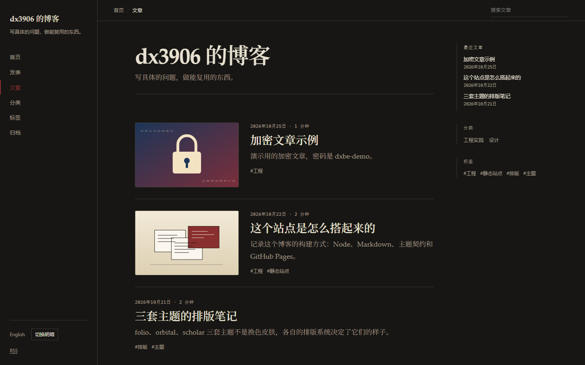

# dxbe

dxbe 是一个面向个人博客的静态站点生成器。用 Markdown 写内容，构建时生成纯静态 HTML；默认中文发布在 `/`，英文发布在 `/en/`；主题、站点身份和部署方式都由配置决定。

这个仓库是 dxbe 引擎本身，不是个人博客。`content/`、`site.config.ts` 和主题截图用于演示与测试。实际博客仓库只安装 `dxbe`，保留内容、配置、`public/` 和一条部署工作流；引擎仓库只跑 CI，不部署站点。



## 特性

- 中文在 `/`，英文在 `/en/`，不生成 `/zh/`；首页可按浏览器语言选择入口，手动切换后记住选择
- 五套完整主题：`folio`（编辑排版）、`orbital`（复古未来主义）、`scholar`（学术）、`apogee`（NASA punk）、`capstan`（磁带未来主义）
- 站点身份、语言、导航、域名、许可证、主题全部在 `site.config.ts`
- Markdown + YAML frontmatter，构建时渲染，客户端零框架
- 文章目录里的图片、PDF 等附件随文章发布；单独一行的 `` 渲染成内嵌 PDF 阅读器 + 链接
- 标签、分类、归档、分页、Atom、sitemap、robots、404、SEO/OG、JSON-LD
- 可选的个人主页布局：首页放简介或简历，文章列表移到 `/posts/`；可选的发表（publications）页，五套主题都有对应布局
- Pagefind 全文搜索，按语言过滤，排除代码和公式
- KaTeX 构建时渲染，仅数学页面加载 CSS
- 确定性构建、内部链接检查、SEO 检查、主题一致性测试
- 引擎仓库跑 Ubuntu + Windows CI；博客实例通过 GitHub Pages 部署，部署后自动 smoke test

## 快速开始

需要 Node.js 24 或更高版本。下面的命令安装 v0.6.0 发布版；apogee / capstan 主题、个人主页、分类、发表页和 PDF 嵌入都从 0.6.0 开始提供。

```bash
mkdir my-blog
cd my-blog
npm init -y
npm install https://github.com/dx3906999/dxbe/releases/download/v0.6.0/dxbe-0.6.0.tgz
npx dxbe setup
npx dxbe dev
```

发布版 tarball 安装不依赖 git 或 SSH。如果改用 `npm install github:dx3906999/dxbe#v0.6.0`，npm 会把依赖记录成 `git+ssh`；CI 需要 SSH key，或把 GitHub 的 SSH URL 重写为 HTTPS。

`setup` 会询问作者、站点标题、英文站点信息、域名和主题，并生成 `site.config.ts`。非交互使用：

```bash
npx dxbe setup --yes --force \
  --name "Your Name" \
  --url "https://example.com" \
  --theme folio
```

博客仓库最终只需要：

```
content/
public/                    # 可选：favicon、CNAME 等
themes/                    # 可选：覆盖或新增主题
site.config.ts
package.json
.github/workflows/deploy.yml
```

引擎、内置主题、检查脚本和 Pagefind 都由 `dxbe` 依赖提供。

## 命令

在博客仓库的 `package.json` 里加：

```json
{
  "scripts": {
    "dev": "dxbe dev",
    "build": "dxbe build",
    "build:all": "dxbe check",
    "preview": "dxbe preview",
    "new": "dxbe new",
    "clean": "dxbe clean",
    "setup": "dxbe setup"
  }
}
```

| 命令 | 作用 |
| --- | --- |
| `dxbe dev` | 本地开发，监听内容、主题和配置，并重建搜索索引 |
| `dxbe build` | 生成 `dist/`，不建搜索索引 |
| `dxbe check` | 构建、链接、SEO、主题一致性、Pagefind 索引 |
| `dxbe index` | 只重建 Pagefind 索引 |
| `dxbe preview` | 静态服务 `dist/` |
| `dxbe new "标题" --slug hello-world --lang zh` | 新建文章目录和 frontmatter |
| `dxbe check:deterministic` | 连续构建两次并比较产物 |
| `dxbe check:theme` | 用当前内容构建全部内置主题 |
| `dxbe clean` | 删除 `dist/`、缓存和开发产物 |
| `dxbe setup` | 交互式生成或更新 `site.config.ts` |
| `dxbe smoke` | 部署后冒烟测试，需要 `BASE_URL` |

生产预览：

```bash
npx dxbe build
npx dxbe index
npx dxbe preview
```

开发模式会为 `.dev-dist/<port>/` 自动重建 Pagefind 索引，本地搜索可用；生产构建仍然单独执行 `npx dxbe index`。

## 构建流程

```
site.config.ts + content/
  → frontmatter 校验
  → Markdown、Shiki、KaTeX
  → 语言、译文、标签、归档、分页
  → 主题布局
  → dist/ + Atom + sitemap + robots
  → Pagefind 索引
```

构建先写入临时目录，完成后替换 `dist/`，不会留下半成品。Pagefind 是独立步骤，只扫描带 `data-pagefind-body` 的文章和页面。

## 站点配置

`site.config.ts` 是唯一的站点身份来源。主要字段：

- `identity.author`：姓名、邮箱、主页、头像
- `identity.social`：GitHub、邮箱、RSS 等
- `identity.repository`：可选的 owner/name，用于页脚源码链接
- `locales.default` / `locales.entries`：语言列表，中英文各自的标题、描述、tagline
- `site.url`：生产域名 origin；CI 会由 `configure-pages` 注入 `SITE_URL`
- `site.base`：站点根路径；项目页由 `SITE_BASE` 注入，例如 `/my-blog`。Windows Git Bash 本地模拟时加 `MSYS_NO_PATHCONV=1`，否则 `/my-blog` 会被转换成 Windows 路径
- `site.customDomain`：设置后生成 `dist/CNAME`
- `site.timezone`：日期展示时区
- `site.license`：页脚展示的代码/内容许可证
- `theme.name`：`folio`、`orbital`、`scholar`、`apogee` 或 `capstan`
- `theme.config`：主题自己的配置，由主题的 zod schema 校验
- `nav`：导航项，路径是语言无关的，渲染时自动加语言前缀
- `home.layout`：`posts`（默认，首页是文章列表）或 `profile`（首页渲染 `home.page` 指定的页面，文章列表移到 `/posts/`）
- `pagination.perPage`：每页文章数
- `features.search` / `features.math`：搜索和公式
- `features.publications`：开启后 `pages/publications.md` 发布在 `/publications/`
- `markdown.allowHtml`：允许正文里的原始 HTML（经过 sanitize），默认关闭；`markdown.shiki`：代码高亮的明暗主题
- `features.autoLanguage`：首页按浏览器语言跳转，默认开启；深链接不跳转，手动选择会记住

自动语言选择只作用于默认语言首页；文章、页面和其他语言首页不会重定向。按浏览器偏好顺序取第一个站点支持的语言，如果它就是默认语言则停留。每个标签页只自动跳转一次，之后返回首页不会被反复重定向。用户点过语言切换后，选择会写入 localStorage，后续访问首页优先按这个选择。设置 `features.autoLanguage: false` 可完全关闭。

所有内部链接由 helper 生成。项目页部署不要手写 `/` 开头的资源路径。完整字段和非交互参数见 [docs/customization.md](docs/customization.md)。

## 内容

```
content/
  zh/posts/how-this-site-works/index.md
  zh/posts/how-this-site-works/cover.jpg
  zh/posts/how-this-site-works/paper.pdf
  en/posts/how-this-site-works/index.md
  zh/pages/about.md
  zh/pages/publications.md
  en/pages/about.md
```

Frontmatter：

```yaml
---
title: 标题
date: 2026-10-22T10:00:00+08:00
updated: 2026-10-23T09:00:00+08:00
tags: [工程, 静态站点]
categories: [工程实践]
slug: how-this-site-works
translationKey: how-this-site-works
summary: 可选的摘要
draft: false
---
```

规则：

- `date` 必须带时区偏移
- 文章和页面的 `slug` 只用小写 ASCII、数字和连字符
- `translationKey` 相同的文章互为译文，默认取目录名
- 同目录的图片、PDF 等文件会复制到文章输出目录，Markdown 用相对路径引用；页面也可以写成 `pages/<slug>/index.md` 带附件
- 草稿在开发模式可见，生产构建排除；未来日期的文章默认排除
- 数学用 `$...$` 和 `$$...$$`；代码块用围栏语法

### PDF

PDF 放进文章目录，单独一行写图片语法：

```markdown


```

构建结果是内嵌阅读器加一行标题链接。多数手机浏览器不能内嵌 PDF，会直接显示链接；打印时只留链接。写在句子中间的 `` 只生成普通链接。`public/` 里的 PDF 用站点路径（`/files/cv.pdf`）引用，项目页部署会自动加 `base`；`dxbe check:links` 会检查 PDF 是否存在。发表页的 `links` 也可以指向站内 PDF。

详细说明见 [docs/authoring.md](docs/authoring.md)。

## 主题

| 主题 | 定位 | 更换方式 |
| --- | --- | --- |
| `folio` | 独立杂志 / 文学期刊；衬线正文、大留白、细规则线 | `theme.name: 'folio'` |
| `orbital` | 70 年代技术手册 / CRT 终端；等宽元信息、网格、磷光强调色 | `theme.name: 'orbital'` |
| `scholar` | 期刊论文；摘要、编号章节、左侧目录、打印样式 | `theme.name: 'scholar'` |
| `apogee` | NASA punk；骨白硬件面板、方格纸、五色条纹、检查清单式目录、Archivo / JetBrains Mono | `theme.name: 'apogee'` |
| `capstan` | 磁带未来主义；米色机身、琴键式按钮、荧光屏、在两根滚轴间走纸的正文、Chakra Petch | `theme.name: 'capstan'` |

本地预览某套主题：

```bash
npx dxbe dev --theme=orbital
npx dxbe dev --theme=scholar
```

主题目录包含 `theme.json`、`theme.ts`、`layouts/`、`assets/`、`i18n/`。自定义主题放在博客仓库的 `themes/<name>/`，同名主题会覆盖内置主题；外部主题从 `dxbe/theme` 导入公共 API。接口说明见 [docs/theming.md](docs/theming.md)，截图见 [docs/theme-gallery.md](docs/theme-gallery.md)。

## 部署到 GitHub Pages

引擎仓库不部署自身。部署工作流是 `templates/deploy.yml`，复制到博客仓库后使用。完整的部署链路在 [dxbe-e2e](https://github.com/dx3906999/dxbe-e2e) 上持续验证，线上地址是 [dx3906999.github.io/dxbe-e2e](https://dx3906999.github.io/dxbe-e2e/)。

1. 创建博客仓库，安装 `dxbe`，放好 `content/`、`site.config.ts` 和 `public/`。免费计划下仓库必须是 public。
2. 把 `templates/deploy.yml` 复制到博客仓库的 `.github/workflows/deploy.yml`。
3. 在 Settings → Pages → Build and deployment → Source 选择 **GitHub Actions**。
4. 推送 `main`，或手动运行 **Deploy**。
5. 工作流完成主题检查、构建、链接/SEO 检查、Pagefind 索引、上传 artifact、部署和 smoke test。

项目页部署时，站点根是 `https://<user>.github.io/<repo>/`。`actions/configure-pages` 会注入 `origin` 和 `base_path`，不需要在配置里写仓库名。

自定义域名：

- 在 `site.config.ts` 设置 `site.customDomain`，构建会生成 `dist/CNAME`
- 在 Pages 设置里填写域名并按 GitHub 的说明配置 DNS
- 开启 Enforce HTTPS

GitHub Pages 没有服务端重定向和自定义响应头；站点总大小限制 1 GB，带宽 100 GB/月，构建频率 10 次/小时。详细说明见 [docs/deployment.md](docs/deployment.md)。

## 引擎开发

仓库里的 `content/` 是演示/测试站点。需要 Node.js 24 或更高版本。

```bash
npm ci
npm run dev
npm run check
```

修改 `src/`、`themes/` 或演示内容会触发 dev server 重建。构建 npm 包：

```bash
npm run build:package
npm pack --dry-run
```

`npm run check` 包含 lint、类型检查、单元/集成测试，以及一次完整构建、链接检查、SEO 检查、主题一致性检查和 Pagefind 索引。

## CI/CD

- `.github/workflows/ci.yml`：PR 和 `main` 推送；Ubuntu + Windows；跑 `npm run check`、确定性检查、actionlint，并验证 npm 包内容
- `templates/deploy.yml`：博客实例的 Pages 部署模板，复制到博客仓库后使用
- `.github/workflows/release.yml`：推送 `v*` tag 时先确认 tag 与 `package.json` 版本一致，再构建 tarball 并创建 GitHub Release；发版前先改 `package.json` 版本号
- `.github/workflows/external-links.yml`：每周检查内容里的外部链接
- `.github/dependabot.yml`：每周更新 npm 和 GitHub Actions

## 目录

引擎仓库：

```
themes/              folio / orbital / scholar / apogee / capstan（随包发布）
src/core/            配置、扫描、Markdown、路由、渲染、输出
src/theme/           主题 API、加载器、资源、i18n
src/cli/             bin 子命令、检查、Pagefind、开发服务器
src/assets/          search.js（随包发布）
scripts/             包构建时复制主题资源和 search.js
tests/               单元和集成测试
docs/                架构、写作、主题、部署、设计检查
content/             演示站点（不随包发布）
site.config.ts       演示配置（不随包发布）
templates/deploy.yml 博客仓库部署模板
```

博客仓库：

```
content/             文章和页面
public/              可选的静态文件
themes/              可选的自定义主题
site.config.ts       站点配置
package.json         依赖 dxbe
.github/workflows/deploy.yml
```

## 设计原则

内置主题不是换色皮肤。界面避免紫色渐变、玻璃拟态、通用 3D 插画、emoji 标题和空泛文案；示例内容写具体的技术或排版问题。完整检查项见 [docs/design-review.md](docs/design-review.md)。

## 许可

- 代码：MIT，见 [LICENSE](LICENSE)
- 内容：CC BY-NC-SA 4.0（可在 `site.config.ts` 中调整声明）
