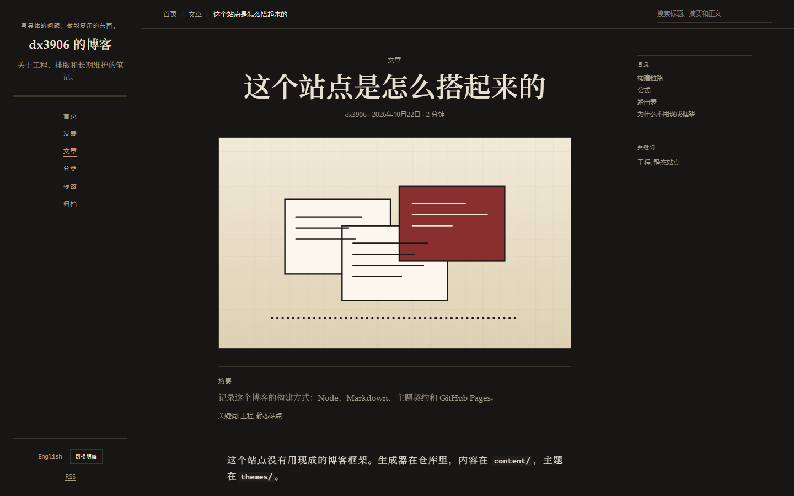
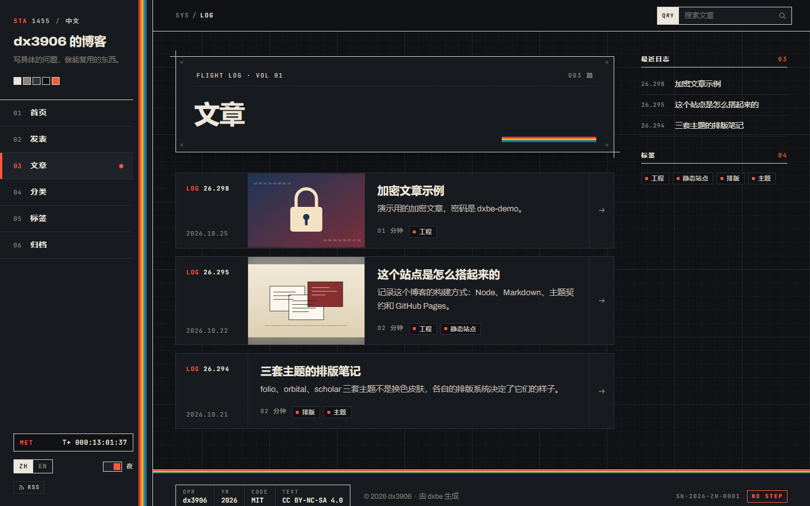
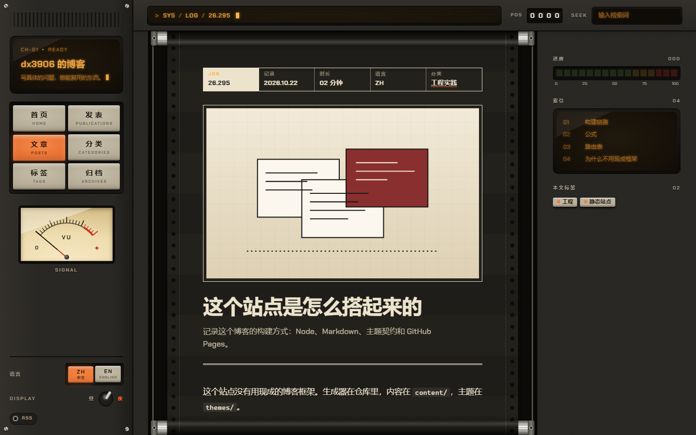

<div align="center">

# dxbe

**一个为个人博客写的静态站点生成器**

Markdown 写作，构建出纯静态 HTML；中英双语、五套完整主题、全文搜索，一条命令发布到 GitHub Pages。

[](https://github.com/dx3906999/dxbe/actions/workflows/ci.yml)
[](https://github.com/dx3906999/dxbe/releases/latest)
[](https://nodejs.org/)
[](LICENSE)

[快速开始](#快速开始) · [教程](docs/tutorial.md) · [主题](#主题) · [文档](#文档) · [更新记录](https://github.com/dx3906999/dxbe/releases)

</div>


## 关于

dxbe 是我给自己的博客写的工具，按自己的写作和发布习惯设计：内容是 Markdown，站点身份全在一个配置文件里，主题负责全部外观，部署只要一条命令。它不打算做成 Hexo、Hugo 那样的通用框架，没有插件系统，功能都是自己用到了才加。

如果它刚好也合你的用法，欢迎直接拿去用。目前还在 0.x 阶段，次版本号之间可能有不兼容改动，升级前看一下 [Release 说明](https://github.com/dx3906999/dxbe/releases)。有问题可以提 issue。

这个仓库是引擎本身，不是博客。仓库里的 `content/` 和 `site.config.ts` 只用来演示和测试；真正的博客放在单独的仓库里，把 dxbe 当依赖安装。

## 特性

**写作**

- Markdown + YAML frontmatter，代码高亮（Shiki）和公式（KaTeX）都在构建时完成，页面不加载渲染脚本
- 文章封面：列表里图文并排，文章页顶部大图，同时作为分享预览图
- 文章目录里的图片、PDF 随文章发布；单独一行的 `` 渲染成内嵌阅读器
- 加密文章：正文在构建时用 AES-256-GCM 加密，读者输入密码后在浏览器里解密
- 可选的个人主页布局（首页放简介，文章列表移到 `/posts/`）和发表（publications）页

**站点**

- 中文在 `/`，英文在 `/en/`；首页按浏览器语言选择入口，手动切换后记住选择
- 标签、分类、归档、分页、Atom、sitemap、robots、404、SEO / Open Graph / JSON-LD
- Pagefind 全文搜索，按语言过滤，不索引代码和公式
- 客户端不用前端框架，每套主题只带一个小脚本

**主题**

- 五套内置主题，每套都实现全部页面类型，支持亮 / 暗模式
- 主题是独立目录，用 TypeScript 写布局；博客仓库里同名主题会覆盖内置主题

**发布与质量**

- `dxbe deploy` 一条命令构建、检查并推送到 GitHub Pages 仓库，源码仓库可以私有；也可以用 GitHub Actions 部署
- 构建先写临时目录再整体替换，输出确定（同样输入两次构建结果逐字节相同）
- 内置内部链接、SEO、主题一致性检查；GitHub Actions 部署完成后自动跑 smoke test
- CI 在 Ubuntu 和 Windows 上都跑

## 快速开始

需要 Node.js 24 或更高版本。

```bash
mkdir my-blog && cd my-blog
npm init -y
npm install https://github.com/dx3906999/dxbe/releases/download/v0.9.0/dxbe-0.9.0.tgz
npx dxbe setup
npx dxbe dev
```

`setup` 会问作者、站点标题、域名和主题，生成 `site.config.ts`，并把仓库补成能直接构建和部署的样子：`package.json` 设为 ESM、补上 `dev` / `build` / `check` 等脚本、生成 `.nvmrc` 和 `.gitignore`。已有的脚本和文件不会被覆盖。也可以不交互：

```bash
npx dxbe setup --yes --force --name "Your Name" --url "https://example.com" --theme folio
```

第一次用的话，[docs/tutorial.md](docs/tutorial.md) 从建仓库、写第一篇文章到部署上线完整走一遍。

> 从 Release 的 tarball 安装不需要 git 或 SSH。如果改用 `npm install github:dx3906999/dxbe#v0.9.0`，npm 会把依赖记成 `git+ssh`，CI 里需要 SSH key 或把 SSH URL 改写成 HTTPS。

博客仓库最后只需要这些：

```
content/                      文章和页面
public/                       可选：favicon、CNAME 等静态文件
themes/                       可选：覆盖或新增主题
site.config.ts                站点配置
package.json                  依赖 dxbe
.github/workflows/deploy.yml  使用 GitHub Actions 部署时
```

## 主题

| 主题 | 风格 |
| --- | --- |
| `folio` | 独立杂志 / 文学期刊：衬线正文、大留白、细规则线 |
| `scholar` | 期刊论文：摘要、关键词、编号章节、打印样式 |
| `orbital` | 70 年代技术手册 / CRT 终端：等宽元信息、技术网格、磷光琥珀色 |
| `apogee` | NASA punk：骨白硬件面板、方格纸底、五色复古条纹、检查清单式目录 |
| `capstan` | 磁带未来主义：米色机身、琴键式导航、琥珀荧光屏、在两根滚轴间走纸的正文 |

<table>
  <tr>
    <td width="50%"><br><sub><code>scholar</code> 文章页</sub></td>
    <td width="50%"><br><sub><code>apogee</code> 文章列表</sub></td>
  </tr>
  <tr>
    <td width="50%"><br><sub><code>capstan</code> 文章页</sub></td>
    <td width="50%"><br><sub><code>orbital</code> 文章页</sub></td>
  </tr>
</table>

在 `site.config.ts` 里写 `theme: { name: 'scholar' }` 换主题，内容不用改。本地先看效果：

```bash
npx dxbe dev --theme=scholar
```

更多截图见 [主题截图](docs/theme-gallery.md)，自己写主题见 [主题开发](docs/theming.md)。

## 命令

| 命令 | 作用 |
| --- | --- |
| `dxbe dev` | 本地开发，监听内容、主题和配置变化，自动重建（含搜索索引） |
| `dxbe new "标题" --slug hello-world` | 新建文章目录和 frontmatter |
| `dxbe build` | 构建到 `dist/`（不含搜索索引） |
| `dxbe index` | 为 `dist/` 生成 Pagefind 搜索索引 |
| `dxbe check` | 构建，并检查链接、SEO、主题一致性，生成搜索索引 |
| `dxbe preview` | 用静态服务器预览 `dist/` |
| `dxbe deploy` | 生产构建、检查，推送到 `deploy.repo`（`--dry-run` 只提交不推送） |
| `dxbe setup` | 交互式生成或更新 `site.config.ts` |
| `dxbe clean` | 删除 `dist/`、缓存和开发产物 |
| `dxbe help [命令]` | 列出全部命令，或查看某个命令的参数和例子 |

另外还有 `check:links`、`check:seo`、`check:theme`、`check:deterministic` 和部署后用的 `smoke`，用 `npx dxbe help` 查看。

## 写作与配置

文章放在 `content/<语言>/posts/<slug>/index.md`，图片、PDF 等附件放在同一目录：

```yaml
---
title: 这个站点是怎么搭起来的
date: 2026-10-22T10:00:00+08:00
tags: [工程, 静态站点]
categories: [工程实践]
summary: 可选的摘要
cover: cover.jpg     # 可选的封面
encrypt: diary       # 可选：按 passwords.yml 里的密码加密正文
draft: false
---
```

`date` 必须带时区；`translationKey` 相同（默认取目录名）的中英文章互为译文；草稿只在开发模式可见。封面、PDF、加密文章和全部字段见 [写作](docs/authoring.md)。

站点身份、语言、导航、主题、首页布局和功能开关都在 `site.config.ts`：

```ts
import { defineConfig } from 'dxbe/config'

export default defineConfig({
  identity: { author: { name: 'Your Name' }, social: [] },
  locales: {
    default: 'zh',
    entries: {
      zh: { label: '中文', title: '我的博客', description: '…' },
      en: { label: 'English', title: 'My Blog', description: '…' },
    },
  },
  site: { url: 'https://example.com', timezone: 'Asia/Shanghai' },
  theme: { name: 'folio' },
  home: { layout: 'profile', page: 'home' },
  features: { search: true, math: true, publications: true },
})
```

配置在加载时按 schema 严格校验，写错的字段会报出路径。所有字段的说明见 [配置与复用](docs/customization.md)。

## 部署

两种方式，都发布到 GitHub Pages：

- **`dxbe deploy`**：在本地构建、检查，然后把 `dist/` 推到配置里 `deploy.repo` 指定的仓库。源码仓库可以私有，用加密文章时必须这样做。
- **GitHub Actions**：把 [`templates/deploy.yml`](templates/deploy.yml) 复制到博客仓库的 `.github/workflows/deploy.yml`，Pages 的 Source 选 **GitHub Actions**，推送 `main` 即可。工作流会构建、检查、生成搜索索引、部署，最后跑 smoke test。

项目页（`<user>.github.io/<repo>/`）的子路径会自动注入，不需要在配置里写仓库名；设置 `site.customDomain` 会生成 `CNAME`。完整的部署链路在 [dxbe-e2e](https://github.com/dx3906999/dxbe-e2e) 上持续验证（[线上地址](https://dx3906999.github.io/dxbe-e2e/)）。细节和常见故障见 [部署](docs/deployment.md)。

## 文档

| 文档 | 内容 |
| --- | --- |
| [从零到上线](docs/tutorial.md) | 建仓库、写文章、部署、日常发布的完整流程 |
| [写作](docs/authoring.md) | 目录结构、frontmatter、封面、PDF、加密文章、公式 |
| [配置与复用](docs/customization.md) | `site.config.ts` 全部字段、增加语言、站点路径、换主题 |
| [部署](docs/deployment.md) | `dxbe deploy`、GitHub Actions、自定义域名、回滚、故障排查 |
| [主题开发](docs/theming.md) | 主题目录、上下文、模板、资源、文案、一致性测试 |
| [主题截图](docs/theme-gallery.md) | 五套主题的截图和选择建议 |
| [升级与发布](docs/releasing.md) | 博客仓库升级 dxbe、引擎发布新版本 |
| [架构](docs/architecture.md) | 构建流水线、模块边界、语言选择、缓存与确定性 |
| [设计检查清单](docs/design-review.md) | 主题的视觉和可用性检查项 |
| [ADR](docs/adr/) | 主要技术决策的记录 |

## 开发

```bash
npm ci
npm run dev      # 用仓库里的演示内容启动 dev server
npm run check    # lint、类型检查、测试，加一次完整构建和全部检查
```

修改 `src/`、`themes/` 或演示内容会触发重建。打包：

```bash
npm run build:package
npm pack --dry-run
```

```
src/core/      配置、内容扫描、Markdown、路由、渲染、输出
src/theme/     主题 API、加载器、资源、i18n
src/cli/       命令行、检查、Pagefind、开发服务器
src/assets/    搜索脚本（随包发布）
themes/        五套内置主题（随包发布）
templates/     博客仓库的部署工作流模板
tests/         单元和集成测试
docs/          文档
content/       演示站点（不随包发布）
```

CI（`.github/workflows/ci.yml`）在 Ubuntu 和 Windows 上跑 `npm run check`、确定性检查和 actionlint，并检查 npm 包内容。推送 `v*` tag 会触发 Release 工作流，校验版本号后构建 tarball 并创建 Release，步骤见 [升级与发布](docs/releasing.md)。

## 设计原则

内置主题不是换色皮肤，每套都有自己的排版系统和页面结构。界面避免紫色渐变、玻璃拟态、通用 3D 插画、emoji 标题和空泛文案；示例内容写具体的技术或排版问题。检查项见 [设计检查清单](docs/design-review.md)。

## 许可

- 代码：[MIT](LICENSE)
- 演示内容：CC BY-NC-SA 4.0；自己博客的内容许可在 `site.config.ts` 的 `site.license` 里声明
