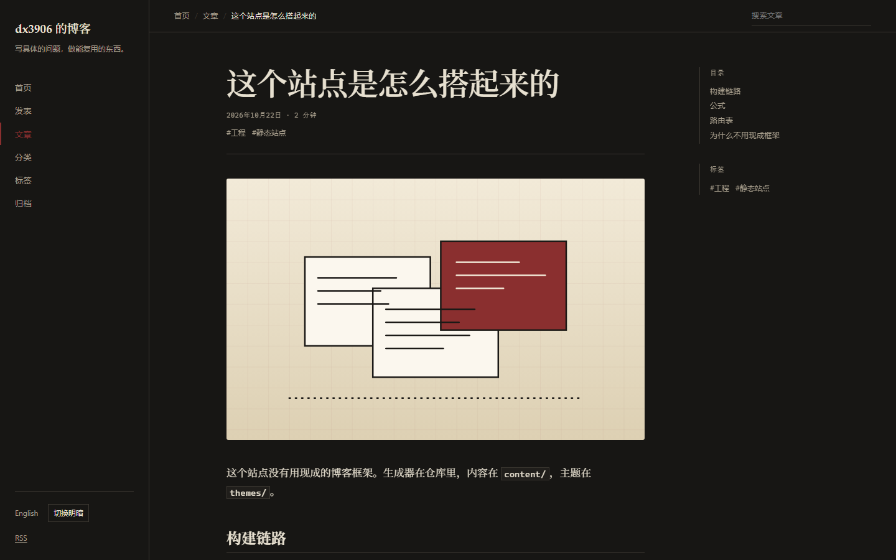
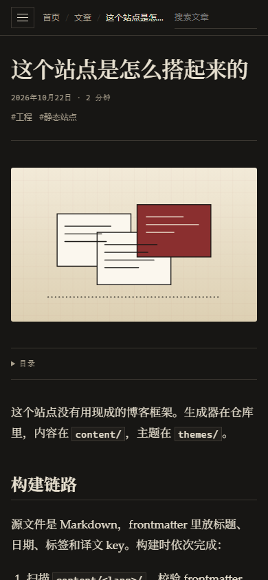
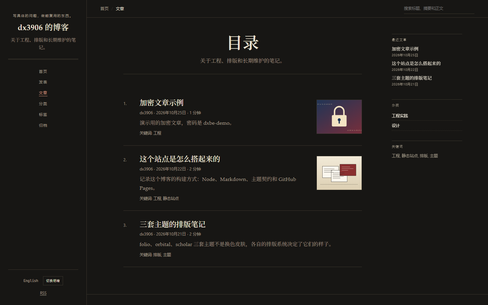
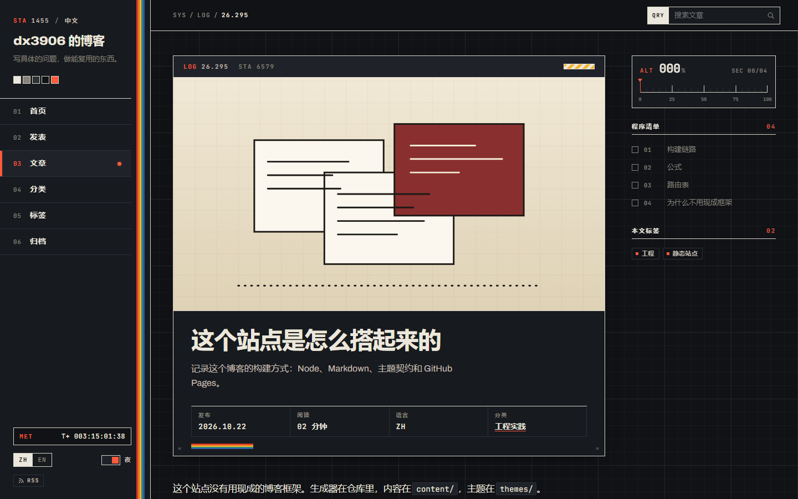
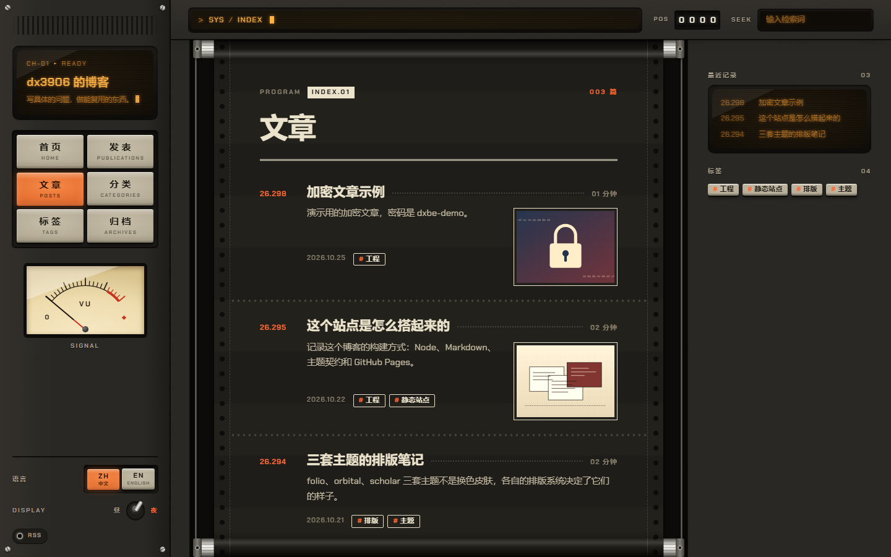

# 主题截图

截图来自本地构建，浏览器为暗色偏好；folio、scholar、apogee、capstan 是 1440×900，orbital 是 1280×900。所有主题都支持亮/暗模式。

## folio

独立杂志 / 文学期刊。衬线正文、大留白、细规则线。左侧导航栏、顶栏面包屑和搜索、右侧目录与最近文章栏，布局与 apogee / capstan 一致。

移动端：

适合：长文、随笔、排版笔记、个人写作。

## orbital

70 年代末技术手册 / CRT 终端。等宽元信息、技术网格、编号章节、磷光琥珀色。

适合：工程日志、系统笔记、带代码和公式的技术文章。

## scholar

期刊论文 / 学位论文。摘要、编号章节、正文衬线。刊头和导航在左侧栏，目录、最近文章和关键词在右侧栏，布局与 apogee / capstan 一致。

适合：研究笔记、文献综述、数学和理论性文章。

## apogee

NASA punk：骨白硬件面板、方格纸底、一道五色复古条纹、满屏等宽编号。左侧导航、右侧检查清单式目录和 ALT 阅读刻度，侧栏有任务计时（MET）。标题用加宽的 Archivo，标签用 JetBrains Mono（仅拉丁字符，自托管）。

适合：工程日志、项目记录、带个人主页和发表页的学术站。

## capstan

磁带未来主义：米色机身、琴键式导航、琥珀荧光屏、机械计数器和指针表。正文是一条在上下两根滚轴之间走动的打印纸带，滚轴随滚动转动。界面统一用 Chakra Petch，代码保持等宽。

适合：技术长文、系统笔记、想要强烈氛围感的个人站。

## 选择建议

- 先确定主要读者和文章类型，再选主题；不要按颜色选。
- 主题可以随时切换，内容不需要改。
- 新增主题前先读 [theming.md](theming.md) 和 [design-review.md](design-review.md)。
